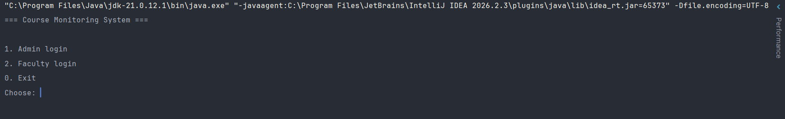
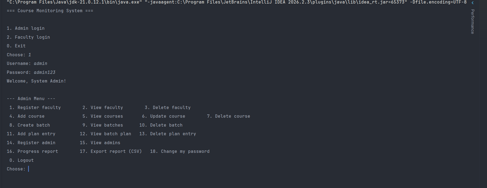
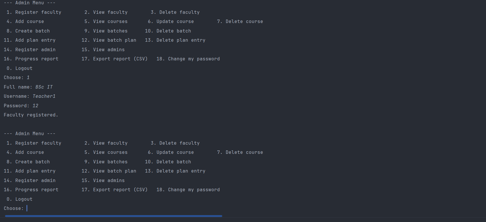
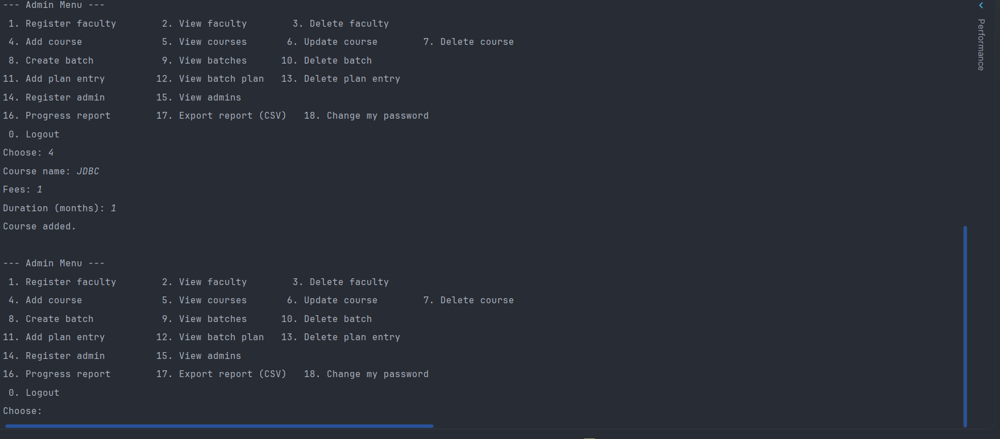

<div align="center">

# 🎓 Course Monitoring System

**A Java + JDBC + MySQL console application for managing courses, batches, teaching plans, and faculty progress.**

Track what is planned, what has been taught, and how far each batch has progressed — all from one application.

<br>


</div>

---

## 📌 Table of contents

- [✨ Overview](#-overview)
- [🖥️ Screenshots](#️-screenshots)
- [🚀 Features](#-features)
- [🧰 Tech stack](#-tech-stack)
- [🗄️ Database design](#️-database-design)
- [⚙️ Getting started](#️-getting-started)
- [📁 Project structure](#-project-structure)
- [🔐 Security](#-security)
- [🛣️ Future improvements](#️-future-improvements)

---

## ✨ Overview

The **Course Monitoring System** is designed for an institute or training centre that needs to organise courses, assign faculty members, create batches, and monitor day-wise teaching progress.

The application has two roles:

- **Admin:** manages faculty, courses, batches, and batch-wise teaching plans.
- **Faculty:** views assigned batches and updates the status of each planned teaching day.

### 🔄 How it works

```text
       ADMIN
         │
         ▼
  Register Faculty
         │
         ▼
    Add Courses
         │
         ▼
    Create Batches ───── Assign Faculty
         │
         ▼
  Prepare Day-wise Plan
         │
         ▼
       FACULTY
         │
         ▼
 Update Daily Status
  PENDING / COMPLETED
         │
         ▼
  Progress Report + CSV
```

---

## 🖥️ Screenshots

### 1. Main menu

The application starts with separate login options for administrators and faculty members.



### 2. Admin dashboard

The admin menu provides access to faculty, course, batch, plan, and reporting operations.



### 3. Faculty registration

Administrators can register faculty members with a name, username, and password.



### 4. Course creation

Administrators can add a course by entering its name, fees, and duration.



---

## 🚀 Features

<table>
<tr>
<th>👨‍💼 Admin</th>
<th>👩‍🏫 Faculty</th>
</tr>
<tr>
<td valign="top">

- Register and view administrators
- Register, view, and delete faculty
- Add, view, update, and delete courses
- Create, view, and delete batches
- Assign a faculty member to a batch
- Create day-wise batch plans
- View progress across batches
- Export progress reports to CSV
- Change account password

</td>
<td valign="top">

- Secure faculty login
- View assigned batches only
- View batch-wise teaching plans
- Mark plan days as `PENDING` or `COMPLETED`
- View progress summary and completion percentage
- Export progress report to CSV
- Change account password

</td>
</tr>
</table>

### 📊 Progress tracking

The system tracks the completion status of each planned day and uses it to calculate batch progress.

```text
Batch progress = (Completed plan days / Total plan days) × 100
```

---

## 🧰 Tech stack

| Technology | Usage |
|---|---|
| **Java 11+** | Application logic and console interface |
| **JDBC** | Java-to-database connectivity |
| **MySQL 8** | Persistent data storage |
| **MySQL Connector/J** | MySQL JDBC driver |
| **CSV** | Exporting progress reports |

---

## 🗄️ Database design

The application uses four main tables:

| Table | Purpose |
|---|---|
| `users` | Stores admin and faculty account details |
| `courses` | Stores course name, fees, and duration |
| `batches` | Connects a course with assigned faculty, start date, and timing |
| `course_plans` | Stores each batch's day-wise topics and completion status |

### Table relationships

```text
users
 ├── Admin / Faculty accounts
 └── Faculty assigned to batches
              │
              ▼
           batches ─────────► courses
              │
              ▼
         course_plans
```

The database uses foreign-key relationships so dependent records can be removed through cascading deletes, as configured in the schema.

---

## ⚙️ Getting started

Follow these steps to run the project locally.

### Prerequisites

Install the following:

- JDK 11 or later
- MySQL Server 8
- MySQL Connector/J
- A terminal or command prompt

### 1. Clone the repository

```bash
git clone <YOUR_REPOSITORY_URL>
cd <YOUR_PROJECT_FOLDER>
```

Replace the placeholders with your repository URL and project folder name.

### 2. Add MySQL Connector/J

1. Download [MySQL Connector/J](https://dev.mysql.com/downloads/connector/j/).
2. Choose the **Platform Independent** package.
3. Place the downloaded `.jar` file inside the project's `lib/` directory.

Your project should contain:

```text
lib/
└── mysql-connector-j-<version>.jar
```

### 3. Create the database tables

Run the schema script from the project root:

**Windows PowerShell**

```powershell
mysql -u root -p -e "source sql/schema.sql"
```

**Linux / macOS**

```bash
mysql -u root -p < sql/schema.sql
```

### 4. Configure the database connection

Copy `db.properties.example` and name the copy `db.properties`.

Update the database URL, username, and password in `db.properties` to match your local MySQL configuration.

> Keep your actual `db.properties` out of version control. Do not commit database passwords.

### 5. Compile the application

**Windows**

```powershell
javac -d out src\com\cms\*.java
```

**Linux / macOS**

```bash
javac -d out src/com/cms/*.java
```

### 6. Run the application

**Windows**

```powershell
java -cp "out;lib/*" com.cms.Main
```

**Linux / macOS**

```bash
java -cp "out:lib/*" com.cms.Main
```

### 🔑 First-time admin login

On the first run, the application creates the initial administrator account:

| Field | Initial value |
|---|---|
| Username | `admin` |
| Password | `admin123` |

**Important:** Change the initial password immediately after logging in.

---

## 📁 Project structure

```text
Course-Monitoring-System/
│
├── lib/
│   └── mysql-connector-j-<version>.jar
│
├── sql/
│   └── schema.sql
│
├── src/
│   └── com/
│       └── cms/
│           ├── Main.java
│           ├── AdminMenu.java
│           ├── FacultyMenu.java
│           ├── AccountService.java
│           ├── ReportService.java
│           ├── DBUtil.java
│           ├── PasswordUtil.java
│           └── Input.java
│
├── db.properties.example
└── README.md
```

---

## 🔐 Security and data handling

Security and data validation are considered in the application:

- Passwords are stored as salted SHA-256 hashes rather than plain text.
- SQL queries use `PreparedStatement` to help protect against SQL injection.
- Faculty update operations verify ownership so faculty members cannot update another faculty member's batch.
- CSV export includes path-traversal protection and spreadsheet formula-injection neutralisation.

---

## 🛣️ Future improvements

- Introduce DAO classes to separate database operations from application logic.
- Add unit tests for services and core functionality.
- Add protection against repeated failed login attempts.
- Build a web or GUI interface for easier access.

---

<div align="center">

### 💡 Built to make course planning and teaching progress easier to manage.

**If you find this project useful, consider giving the repository a ⭐**

</div>
